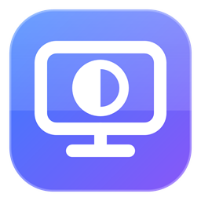
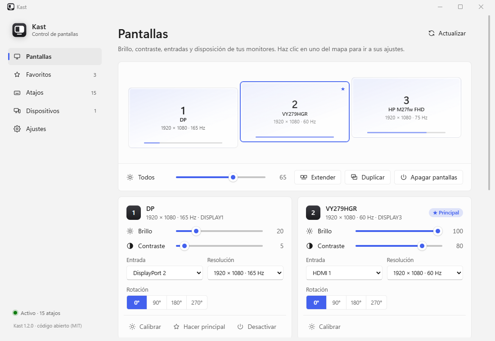
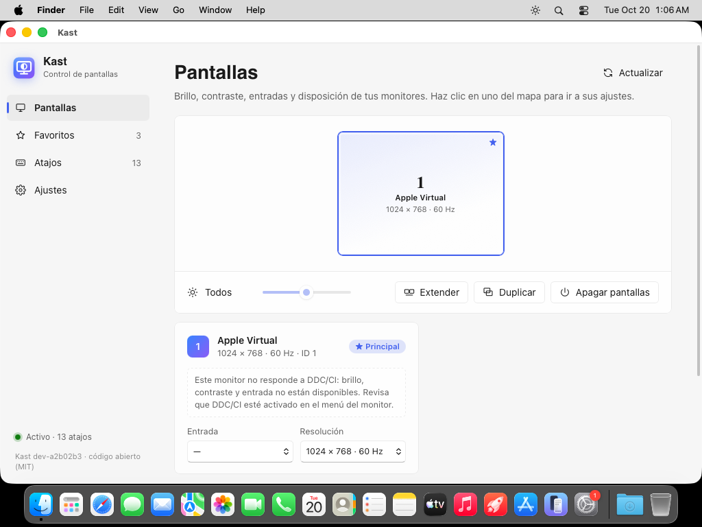

<p align="center"></p>

<h1 align="center">Kast</h1>

<p align="center">Control de monitores para <b>Windows</b> y <b>macOS</b>: brillo, contraste, entradas, resolución y disposición,<br>desde la bandeja o la barra de menús, con atajos globales y una interfaz moderna.<br>Y con <b>Kast Link</b>, ve y controla tus otros equipos desde cualquiera de tus monitores, desde el <b>iPhone y el iPad</b> o desde <b>Android</b>, cifrado y por la red local.</p>

<p align="center"><a href="https://github.com/AbrahmCh1/Kast/releases">Descargar</a> · <a href="#windows">Windows</a> · <a href="#macos">macOS</a> · <a href="#kast-link">Kast Link</a> · <a href="#ios-iphone-y-ipad">iOS</a> · <a href="#android">Android</a></p>

<p align="center"></p>

## Características

**Monitores**
- **Brillo, contraste, volumen y entrada** de cada monitor por DDC/CI, en paralelo y respetando los tiempos del protocolo.
- **Calibración de brillo y contraste por monitor**, comparando en vivo con los demás, para que el mismo porcentaje se vea igual en pantallas distintas.
- **Resolución, frecuencia, rotación y monitor principal**; activar y desactivar monitores.
- **Extender y duplicar** sobre todos los monitores conectados (no sólo los que recuerda Windows).
- **Disposiciones guardadas**: posición, resolución y monitores activos, restaurables con un clic o un atajo. En Windows también recuerdan qué otros equipos tenías a pantalla completa y en qué monitor.
- **Favoritos**: secuencias de comandos (`b all 20; c all 40`) aplicables desde la bandeja o con un atajo.
- **Atajos globales** configurables, grabados pulsando la combinación.
- **Cambios seguros**: resolución, rotación, duplicar y disposiciones se revierten solos a los 15 s si no se confirman.
- **CLI completa** (`kast.exe`) para scripts.

**[Kast Link](#kast-link): tus otros equipos**
- **Ver y controlar** otro equipo Windows o Mac, como AnyDesk: una o **varias de sus pantallas a la vez**, cada una en una ventana o a pantalla completa en uno de tus monitores.
- **Pantallas virtuales**: si el otro equipo tiene una pantalla y tú tienes tres monitores, le añades las que quieras, con el tamaño de tus monitores y colocadas como ellos; el ratón (y lo que arrastras) pasa de una a otra. En un Mac sin instalar nada; en Windows, con el controlador de pantalla virtual de Parsec.
- **Portapapeles compartido** (texto e imágenes), **archivos arrastrando** en los dos sentidos (a la ventana para enviarlos; desde el Finder del Mac que ves en Windows, hasta tu escritorio, para traerlos) y **atajos del sistema** (`Win`, `Alt+Tab`…) hacia el otro equipo.
- **Acceso:** ID de 9 dígitos por equipo, emparejamiento con código de un solo uso, acceso desatendido con contraseña y lista de dispositivos con acceso.
- **[App para iPhone y iPad](#ios-iphone-y-ipad)** con modo trackpad, modo táctil y teclado completo.
- **[App para Android](#android)**: ve y controla tus equipos y, en **pantallas grandes** (tabletas y pantallas interactivas), comparte la suya para controlarla desde tu PC o Mac.
- Cifrado de extremo a extremo (Noise XX), sin servidores ni cuentas.

# Windows

## Ligero de verdad

| | |
|---|---|
| `kast.exe` (CLI) | ~105 KB |
| `kastd.exe` (bandeja + atajos) | ~210 KB; **~250 KB de RAM** en reposo (2-3 MB tras haber abierto la interfaz), 0 % de CPU |
| `kast-link.exe` (Kast Link) | ~1,5 MB; sólo usa CPU mientras hay una sesión abierta |
| Ventana de configuración | WebView2 creado **sólo mientras está abierta**; al cerrarla se liberan sus procesos |

Sin runtime, sin frameworks: Win32 + DXVA2 (DDC/CI) + CCD (`SetDisplayConfig`), compilado con `zig cc`.

## Requisitos

- Windows 10 u 11 (x64).
- [Runtime de WebView2](https://developer.microsoft.com/microsoft-edge/webview2/) para la ventana de configuración (incluido en Windows 11).
- Para brillo/contraste/entrada: monitores con **DDC/CI** activado en su menú.

## Compilar

```powershell
winget install zig.zig
.\build.ps1
```

Genera `bin\kast.exe`, `bin\kastd.exe` y copia `WebView2Loader.dll` y un `kast.ini` de ejemplo. Si tienes Rust (toolchain MSVC, o GNU con las binutils de MinGW-w64), también compila `bin\kast-link.exe`.

## Uso

Ejecuta `kastd.exe` para tener Kast en la bandeja: clic para abrir la interfaz, clic derecho para favoritos y acciones rápidas. Para iniciarlo con Windows: **Ajustes → Iniciar con Windows** o `kast autostart on`.

Desde la terminal:

```powershell
kast list                      # monitores (1..n de izquierda a derecha, * = principal)
kast b all 40                  # brillo de todos al 40 %
kast b c +10                   # +10 % al monitor que tiene el cursor
kast "b all 20; c all 40"      # secuencias con ;
kast input 2 hdmi2             # cambiar entrada
kast mode 1 1920x1080@144      # resolución y frecuencia
kast topo extend               # extender a todos los monitores conectados
kast layout save escritorio    # guardar la disposición actual
kast fav Noche                 # aplicar un favorito
kast help                      # referencia completa
```

Monitores: `1`, `1,3`, `all`, `p` (principal) o `c` (el que tiene el cursor).

## Configuración

`kast.ini`, junto a los ejecutables (la interfaz lo edita por ti):

```ini
[favoritos]
Noche = b all 20; c all 40

[atajos]
ctrl+alt+up = b c +10
ctrl+alt+1 = fav Noche
ctrl+alt+num9 = layout load Desktop

[calibracion]
# brillo real de cada monitor (en % de su escala) para cada nivel de Kast: nivel:valor
VY279HGR = 0:10 50:40 100:85

[calibracion-contraste]
VY279HGR = 0:30 100:75
```

### Calibrar monitores

Cada monitor tiene su propia escala: en uno el 100 % de brillo puede verse como el 75 % de otro. Con **Calibrar**, en la tarjeta de cada monitor, eliges qué valor real del monitor corresponde a cada nivel de Kast (0, 25, 50, 75 y 100 %), por separado para el brillo y el contraste. Al mover cada control, ese monitor muestra el valor y los demás se ponen en ese mismo nivel de Kast para compararlos. **Guardar** lo escribe en `kast.ini`, y desde entonces `b`, `c`, los favoritos, los atajos y la interfaz usan esa escala.

- Ajusta los extremos y sólo los niveles intermedios que no coincidan. Los que no toques siguen la recta entre los ajustados, y sólo se guardan los ajustados.
- Con **−** y **+** vas de un valor real del monitor al siguiente. Sirve para monitores que cambian mucho en pocos valores, como uno cuyo contraste varía casi todo entre 0 y 10.
- Para ver o fijar el valor real sin calibración: `kast braw` y `kast craw`.
- El formato anterior, `monitor = mínimo máximo` (solo el 0 % y el 100 % del brillo), se sigue leyendo.

> `Ctrl + Alt` equivale a `AltGr`: evita combinaciones que uses para escribir.

# macOS

<p align="center"></p>

App nativa en Swift que vive en la **barra de menús**: control de brillo por monitor directamente en el menú, favoritos, extender/duplicar, Kast Link y la misma ventana de configuración que en Windows (WKWebView, creada sólo al abrirla). Binario universal (Apple Silicon e Intel), macOS 12 o posterior.

## Instalar

1. Descarga `Kast-<versión>-macos.dmg` de [Releases](https://github.com/AbrahmCh1/Kast/releases), ábrelo y arrastra **Kast** a *Aplicaciones*. También está el `.zip` (el único formato hasta la 1.5.0): descomprímelo y mueve **Kast.app** a *Aplicaciones*.
2. Ábrela: la app y la imagen de disco están **firmadas con Developer ID y notarizadas por Apple**, así que se abren sin avisos, y los permisos que le des (Grabación de pantalla, Accesibilidad) se conservan al actualizar.
3. Para usar la CLI desde la terminal:

```bash
sudo ln -sf /Applications/Kast.app/Contents/MacOS/Kast /usr/local/bin/kast
```

Los comandos, favoritos, atajos y la calibración son los mismos que en Windows. La configuración vive en `~/Library/Application Support/Kast/kast.ini`. Los atajos usan `ctrl`, `alt` (⌥), `shift` y `cmd` (⌘), y no requieren permisos de accesibilidad.

## Qué funciona en macOS

| Función | Estado |
|---|---|
| Brillo de la pantalla integrada | ✓ |
| Brillo, contraste, volumen y entrada de monitores externos (DDC/CI) | ✓ en Apple Silicon · ✗ en Macs Intel |
| Resolución, frecuencia y monitor principal | ✓ |
| Extender / duplicar, disposiciones guardadas | ✓ (las disposiciones aún no guardan pantallas de otros equipos) |
| Favoritos, atajos globales, inicio con la sesión | ✓ |
| Kast Link: compartir, ver y controlar | ✓ |
| Rotar o desactivar monitores | ✗ (macOS no lo permite con API pública) |

## Compilar

```bash
bash mac/build.sh 1.0.0    # genera mac/build/Kast.app (requiere Xcode o Command Line Tools)
```

Sin más, la app se firma *ad hoc*. Para firmarla con tu certificado (Hardened Runtime, lista para notarizar): `KAST_SIGN_ID="Developer ID Application: …" bash mac/build.sh 1.0.0`. La CI de este repositorio firma y notariza cada versión con los secretos `MAC_CERT_P12`, `MAC_CERT_PASSWORD`, `ASC_KEY_P8`, `ASC_KEY_ID` y `ASC_ISSUER_ID`; sin ellos, firma *ad hoc*.

# Kast Link

Ver y **controlar** otro equipo (como AnyDesk) en uno de tus monitores, por la red local y **cifrado**. Windows y macOS se entienden entre sí: cualquiera puede compartir y cualquiera puede ver; desde iOS y Android se puede ver y controlar, y una tableta o pantalla interactiva Android también se puede compartir. Es la base de un sistema para unificar varios equipos y asignar pantallas de uno a otro.

## Conectar

Todo se hace desde Kast → **Dispositivos**.

1. Abre Kast en los dos equipos. Se encuentran solos en la red local; si no, usa **Agregar dispositivo** con la IP del otro, o **Conectar por ID** con su ID de 9 dígitos.
2. En el que va a ver: en la tarjeta del dispositivo marca **qué pantallas suyas** quieres (una o varias a la vez) y **dónde mostrar cada una** (en una ventana o a pantalla completa en uno de tus monitores), añade si quieres [pantallas virtuales](#pantallas-virtuales) y pulsa **Conectar**. Con **Controlar teclado y ratón** (activado por defecto) puedes escribir, hacer clic, arrastrar y desplazarte en el otro equipo; cada pantalla se controla desde su propia ventana.
3. El otro equipo te deja entrar de una de estas formas:
   - **Aceptando la petición:** muestra un **código de 6 dígitos** que debe coincidir con el tuyo, y permite el control o sólo la vista. Si pides varias pantallas, una sola aprobación las cubre todas. Con **Recordar este dispositivo** no vuelve a preguntar.
   - **Emparejados:** si os emparejasteis con un código, entras sin preguntar.
   - **Con su contraseña de acceso desatendido:** pulsa **Contraseña o código** en la tarjeta del dispositivo.

Desde **Dispositivos** se ven las sesiones activas y se pueden cortar, y el interruptor **Permitir que otros vean mis pantallas** desactiva las peticiones entrantes.

## En el visor

- Sin control: `Esc` cierra la ventana y `F11` alterna pantalla completa.
- Con control, todas las teclas van al otro equipo, así que se usan `Ctrl+Alt+Shift+F` (pantalla completa) y `Ctrl+Alt+Shift+Q` (cerrar). Al cambiar de ventana se sueltan las teclas pulsadas.
- **Atajos del sistema** (visor en Windows): con la ventana en primer plano, `Win`, `Alt+Tab`, `Alt+F4`, `Alt+Esc`, `Alt+Espacio` y `Ctrl+Esc` van al otro equipo en vez de actuar en el tuyo (`Ctrl+Alt+Supr` y `Win+L` siempre se quedan en tu equipo).
- Entre Windows y Mac, `Ctrl` y `Cmd` se intercambian para que los atajos (copiar, pegar…) funcionen como esperas; en un Mac remoto, `Ctrl+Tab` cambia de app (`Cmd+Tab`).
- **Portapapeles compartido:** lo que copias en un equipo se puede pegar en el otro, en los dos sentidos (texto e imágenes).
- **Archivos:** arrastra archivos o carpetas a la ventana del visor y se copian a la carpeta **Descargas** del otro equipo, que los muestra en el Explorador o el Finder. Se envían en segundo plano: mientras tanto sigues moviendo el ratón, escribiendo y viendo la pantalla (el teclado y el ratón pasan siempre por delante), y puedes cerrar la ventana. El progreso aparece en el título de la ventana.
- **Traer archivos arrastrando** (viendo un Mac desde Windows): en el visor, arrastra archivos o carpetas desde el Finder del Mac y sácalos de la ventana hasta tu escritorio o una carpeta del Explorador, como en AnyDesk. Se copian al soltar (si aún están llegando, Windows espera a que lleguen enteros) y el arrastre en el Mac se cancela, así que allí no se mueve nada. La primera vez, macOS puede pedir permiso para que Kast lea esa carpeta (Escritorio, Documentos…): acéptalo en el Mac. Desde un Mac viendo Windows todavía no se puede.

El portapapeles y los archivos sólo funcionan en sesiones con control.

## Pantallas virtuales

Para manejar un equipo con más pantallas de las que tiene (un Mac o un PC con un monitor, desde tu equipo con tres), Kast le crea **pantallas virtuales** mientras lo ves:

1. En la tarjeta del equipo, elige en qué monitor tuyo ves su pantalla real.
2. Pulsa **Añadir pantalla virtual** (o un monitor **libre** en el mapa «Así quedará en tus monitores») y elige en qué monitor tuyo irá cada una, o **En una ventana** si no te quedan monitores libres. Por ejemplo, con tres monitores y queriendo usar dos: su pantalla en el del centro y una virtual en el de la derecha. Desde un portátil o un equipo con un solo monitor: su pantalla en tu monitor y la virtual en una ventana.
3. **Conectar**: con una sola aprobación, el equipo crea cada pantalla virtual con la resolución y la escala de tu monitor (en un Mac, Retina si tu monitor está al 150 % o más) y la **coloca junto a la suya como están tus monitores**: a la derecha, a la izquierda, encima o debajo, a la misma altura. Cada una se abre a pantalla completa en su monitor (o en su ventana).

Así el ratón pasa de una pantalla a otra como entre tus monitores, y con el botón pulsado puedes **arrastrar ventanas** de su pantalla a la virtual. Al cerrar la ventana de una pantalla virtual (o desconectar), el equipo la quita y lleva sus ventanas a las que quedan; si Kast se cierra, también desaparecen. Sólo existen mientras las ves: no cambian la configuración de pantallas guardada del equipo. En un Mac aparecen en Ajustes del Sistema → Pantallas como «Kast · <tu equipo>»; en Windows, en Configuración → Pantalla, como una pantalla más (de Parsec).

- Una virtual **en una ventana** tiene el tamaño de tu monitor principal y se coloca a la derecha de lo que ves a pantalla completa (si todo va en ventanas, a la derecha de sus pantallas). Arrastrar ventanas de su pantalla a la virtual funciona igual de una ventana de Kast a otra.
- Un **Mac** puede crearlas con macOS 11 o posterior, sin instalar nada. Si no tiene ningún monitor activo (por ejemplo, porque el suyo está en la entrada de otro equipo), macOS le pone una pantalla de reemplazo que quita en cuanto aparece otra; Kast la sustituye antes por una virtual del tamaño de tu monitor, así que tendrá tantas pantallas como pidas.
- Un **Windows** necesita el controlador de pantalla virtual de Parsec (Parsec VDD), que viene con [Parsec](https://parsec.app) y también se instala suelto desde [parsec-vdd](https://github.com/nomi-san/parsec-vdd). Windows no trae ninguno, y uno propio de Kast tendría que firmarlo Microsoft. Kast usa el modo del controlador más parecido al de tu monitor (tiene los habituales, de 1280×720 a 4096×2160). Si el equipo no lo tiene, su tarjeta lo indica.
- Una disposición guardada con pantallas virtuales las vuelve a crear al aplicarla.

## Acceso a este equipo

En Dispositivos → **Acceso a este equipo**:

- **Tu ID:** 9 dígitos (por ejemplo `482 913 057`) para que otros se conecten con **Conectar por ID**. De momento funciona dentro de la misma red; es la base para conectarse desde fuera.
- **Dispositivos desconocidos:** «Preguntar» (cada petición se acepta en pantalla) o «Rechazar» (sólo entran los emparejados o con la contraseña, sin interrumpirte con peticiones).
- **Emparejar un dispositivo:** genera un código de un solo uso (por ejemplo `K7QM-4ZP2`, válido 10 minutos) con el permiso que elijas: ver, o ver y controlar. En el otro dispositivo: **Contraseña o código** → Código. Desde entonces entra sin preguntar.
- **Acceso desatendido:** una contraseña (mínimo 8 caracteres) para entrar sin que nadie acepte, con su permiso. Al cambiarla o desactivarla se cortan las sesiones que entraron con ella, y mientras alguien está conectado con ella se avisa en este equipo.
- **Dispositivos con acceso:** los emparejados y recordados, con su permiso y su último acceso. **Quitar acceso** los obliga a volver a pedir permiso y corta su sesión.

**Varias pantallas:** al aceptar (o al entrar con contraseña o código), el equipo concede las pantallas pedidas a ese grupo de conexiones: las demás se abren, o se cambia de una a otra en iOS, sin volver a preguntar mientras alguna siga abierta. Al cerrarlas todas, volver a entrar pide permiso como siempre.

La contraseña y el código **nunca se envían**: el equipo manda una sal y el otro responde con una prueba (Argon2id + BLAKE2s-MAC) ligada a esa conexión concreta, que no sirve en ninguna otra. La contraseña se guarda sólo derivada con Argon2id. Tras 5 intentos fallidos en 10 minutos, ese dispositivo queda bloqueado 5 minutos; cada fallo se avisa y se registra.

## En una disposición (Windows)

Si guardas una disposición de pantallas mientras tienes otro equipo a pantalla completa en uno de tus monitores, la disposición lo recuerda. Al aplicarla (desde Kast o con su atajo), se restauran los monitores y se vuelve a abrir esa pantalla remota en su monitor, con control si lo tenía.

- Las sesiones que ya coinciden se mantienen.
- Las de pantalla completa que no forman parte de la disposición se cierran; también al aplicar una disposición sin otros equipos.
- Las sesiones en ventana no se tocan.

Para que no haya que aceptar nada al aplicarla, empareja el dispositivo o marca **Recordar este dispositivo** en el otro equipo.

## Permisos (la primera vez)

- **Windows:** el del firewall (puertos 47800 TCP y 47801 UDP, redes privadas). Las ventanas de administrador y los avisos de UAC no aceptan el control remoto, igual que en otras herramientas sin servicio del sistema.
- **Mac:** **Red local** (para encontrar otros equipos), **Grabación de pantalla** (para compartir) y **Accesibilidad** (para que te controlen). Si falta alguno, Kast → Dispositivos muestra «Dar permiso».
- **iPhone y iPad:** **Red local** (para encontrar tus equipos).
- **Android (pantallas grandes, para compartir):** el de **captura de pantalla** (al pulsar Compartir), **Accesibilidad → Kast (control remoto)** (para que te controlen), **Mostrar sobre otras apps** (para aceptar conexiones con Kast en segundo plano) y **Notificaciones**.

## Cómo funciona

| | Windows | macOS | Android (compartir) |
|---|---|---|---|
| Captura | DXGI Desktop Duplication | ScreenCaptureKit (NV12 directo de la GPU) | MediaProjection en una pantalla virtual que dibuja en el codificador |
| H.264 | Media Foundation | VideoToolbox (hardware) | MediaCodec (hardware), hasta 1080p a 30 fps |
| Formato en la red | Annex B | AVCC ↔ Annex B, con el SPS ajustado a latencia mínima | Annex B, con SPS/PPS en cada fotograma clave |
| Teclado y ratón | `SendInput` (códigos de escaneo y Unicode) | `CGEvent` (con permiso de Accesibilidad) | Servicio de Accesibilidad: gestos (`dispatchGesture`) y el campo de texto activo (Android 13+) |
| Pantallas virtuales | Controlador de Parsec (IddCx) por `DeviceIoControl`, colocadas con `SetDisplayConfig` | `CGVirtualDisplay`, colocadas con `CGConfigureDisplayOrigin` | — |

| Medido en red local (1080p, 60 fps) | |
|---|---|
| Captura + codificación H.264 | ~4 ms por fotograma |
| Decodificación | ~5 ms |
| Latencia de la captura a la imagen lista | ~5-10 ms (+ red) |
| Ancho de banda (escritorio) | 2-5 Mbps; hasta 20 Mbps con vídeo |

- **Seguridad:** cada equipo tiene una identidad propia (X25519) y la conexión usa Noise XX (autenticación mutua + ChaCha20-Poly1305). El equipo que comparte siempre decide quién entra: aceptando cada petición, o dejando entrar a los dispositivos que emparejó o a quien conozca su contraseña de acceso desatendido. Si la identidad de un dispositivo conocido cambia, la conexión se bloquea.
- **Descubrimiento:** cada equipo se anuncia por UDP (difusión) y responde a consultas directas, que es como lo encuentran las apps de iOS y Android.
- **Arquitectura:** el núcleo (`link/`) es una biblioteca en Rust. En escritorio, la app arranca `kast-link agent`, que se comunica con ella por stdin/stdout (una línea JSON por mensaje) y abre las ventanas del visor. En iOS, la misma biblioteca se enlaza en la app (`link/src/mobile.rs`); en Android, como biblioteca JNI (`link/src/android/`), que además comparte la pantalla.
- **Todo nativo:** las APIs de captura, vídeo y entrada que ya trae cada sistema, sin códecs ni librerías externas.
- **Hoja de ruta:** conectarse desde fuera de casa (servidor de encuentro y relé, y después conexión directa), cruce transparente del ratón entre monitores de distintos equipos, atajos del sistema también desde un visor en Mac (`Cmd+Tab`…) y recibir archivos desde un visor en Mac.

Pruebas: `cargo test --manifest-path link/Cargo.toml` y `python3 link/tests/e2e.py <kast-link>` (dos agentes en el mismo equipo: descubrimiento, aprobación, control, disposiciones, archivos, cliente de iOS, contraseña, emparejamiento, límite de intentos, varias pantallas, archivos y pantallas virtuales).

# iOS (iPhone y iPad)

App para **ver y controlar tus equipos** con Kast desde el iPhone o el iPad, por la red local y con el mismo cifrado que Kast Link. No comparte su propia pantalla.

- **Dispositivos:** encuentra solos los equipos con Kast en tu Wi-Fi, con su ID. También puedes agregarlos por IP o **Conectar por ID** (botón **+**).
- **Conectar:** toca un equipo, elige la pantalla, si quieres controlarlo y cómo entras: pidiendo permiso, con su **contraseña de acceso desatendido** o con un **código de emparejamiento**. Si el equipo sólo acepta emparejados o con contraseña, la app te la pide.
- **Modo trackpad** (por defecto):
  - desliza un dedo para mover el cursor (con aceleración);
  - toca = clic; dos dedos = clic derecho;
  - mantén pulsado y arrastra = arrastrar;
  - dos dedos deslizando = desplazamiento.
- **Modo táctil:** tocas donde quieres hacer clic; mantener = clic derecho.
- **En vertical:** la pantalla remota arriba y debajo un panel de trackpad con botones de **clic izquierdo y derecho** (se pueden mantener pulsados para arrastrar). Con el teclado abierto, el panel se encoge.
- **Zoom:** pellizca para acercarte; la vista sigue al cursor.
- **Cambiar de pantalla:** si el equipo tiene varias, el botón de pantallas de la barra pasa de una a otra sin que vuelva a preguntar.
- **Teclado:**
  - el de iOS escribe tal cual (acentos, ñ, emojis);
  - la barra de encima añade Esc, Tab, flechas, Supr, Inicio/Fin, RePág/AvPág, F1-F12, los modificadores Ctrl, Alt/⌥, Win/⌘ y ⇧ (se fijan con un toque) y un menú de atajos del sistema remoto;
  - en el iPad funcionan el teclado físico, el ratón y el trackpad.
- **Portapapeles:** el botón lo envía al otro equipo, y lo que copias allí llega al iPhone.

Usa el núcleo de Kast Link en Rust como biblioteca estática (`link/src/mobile.rs`, API en `ios/Kast/kastlink.h`) y una interfaz en SwiftUI y UIKit, con el vídeo decodificado por hardware (`AVSampleBufferDisplayLayer`). El descubrimiento consulta directamente cada equipo de la red, así que no necesita el permiso de multidifusión de Apple.

**Instalar en tu iPhone o iPad** (firma de desarrollo, sin App Store), desde un Mac con Xcode y Rust (`rustup target add aarch64-apple-ios aarch64-apple-ios-sim`):

1. Conecta el iPhone por cable, acepta «Confiar en este ordenador» y activa **Ajustes → Privacidad y seguridad → Modo desarrollador**.
2. Inicia sesión con tu cuenta de Apple en Xcode → Ajustes → Cuentas, y cambia `DEVELOPMENT_TEAM` en `ios/Kast.xcodeproj` por tu equipo.
3. `bash ios/build.sh device` e instala con `xcrun devicectl device install app --device <id> ios/build/Release-iphoneos/Kast.app`, o abre `ios/Kast.xcodeproj` en Xcode y pulsa ▶︎.

Para el simulador: `bash ios/build.sh sim`.

# Android

App para **ver y controlar tus equipos** con Kast desde un teléfono o una tableta Android y, en **pantallas grandes** (tabletas y pantallas interactivas), para **compartir la suya**: aparece en Kast → Dispositivos de tu PC o Mac como un equipo más y la ves y controlas desde allí.

**Compartir esta pantalla** (pantallas grandes, columna «Esta pantalla»):

1. Pulsa **Compartir esta pantalla** → **Empezar ahora** (permiso de captura de Android). Mientras comparte hay un aviso fijo con «Dejar de compartir»; el codificador sólo trabaja mientras alguien está viendo.
2. En **Permisos**, **Activar** el control: Accesibilidad → **Kast (control remoto)**. Y **Avisos de conexión encima de otras apps**, para que la petición aparezca aunque Kast esté en segundo plano y para que vuelva a compartir sola al encender la pantalla.
3. En tu PC o Mac: Kast → Dispositivos → la pantalla → **Controlar**, y acepta en ella comprobando el código. Igual que en el escritorio, hay **emparejamiento** con código de un solo uso, **acceso desatendido** con contraseña, **rechazar desconocidos** y la lista de **dispositivos con acceso**.

Al controlarla:
- el ratón se convierte en gestos: clic = toque (mantenido = pulsación larga), arrastrar = deslizar el dedo y la rueda desplaza sin inercia;
- botón derecho (o el de Atrás del ratón) = **Atrás**, botón central = **Inicio**, `Esc` = Atrás y la tecla Windows/⌘ sola = Inicio;
- lo que tecleas se escribe en el campo de texto activo con la distribución de **tu** teclado (acentos y ñ incluidos), y `Ctrl+C/V/X/A`, flechas, Borrar y Entrar funcionan (Android 13+); sin un campo activo, las flechas y Entrar mueven el foco;
- lo que copias en el visor llega al portapapeles de Android, y los archivos que arrastras a la ventana, a **Descargas/Kast**;
- la imagen viaja a 1080p como máximo (H.264 por hardware), suficiente para una pantalla 4K.

**Ver y controlar otros equipos** (cualquier Android): los equipos de tu red aparecen solos (o por IP o por ID); pulsa **Controlar** o **Ver**, o en **Más…** entra con contraseña o código. Con el dedo: tocar = clic, mantener = clic derecho, arrastrar = arrastrar con el botón pulsado y dos dedos = rueda (tocar con dos dedos = clic derecho). Un ratón o un teclado conectados funcionan tal cual, y **Teclado** abre el de pantalla.

**Instalar** (sin Play Store): el `Kast-<versión>-android.apk` del Release, o compílalo con el SDK y el NDK de Android, JDK 17+ y Rust (`rustup target add aarch64-linux-android armv7-linux-androideabi x86_64-linux-android`); con el dispositivo conectado por `adb`:

```bash
cd android && ./gradlew installDebug -PkastAbis=arm64-v8a
```

## Pantalla siempre compartida

Para dejar una pantalla compartiendo sin nadie delante. Con **Mostrar sobre otras apps** activado, Kast vuelve a compartir sola al encenderse, al actualizarse, si Android corta la captura o si cierra la app. Y mientras alguien está conectado, enciende la pantalla y no deja que se apague. Sólo deja de compartir con su botón **Dejar de compartir**.

Lo único que Android no deja automatizar desde la app es el diálogo de captura («Empezar ahora»). Se concede una vez desde un equipo con `adb`, y Android deja de preguntar, también tras reiniciar o actualizar:

```bash
adb shell appops set io.github.abrahmch1.kast PROJECT_MEDIA allow
```

Para que el ahorro de energía no la cierre nunca:

```bash
adb shell dumpsys deviceidle whitelist +io.github.abrahmch1.kast
```

Como nadie va a aceptar en la pantalla, **empareja** tu PC o Mac (código de un solo uso) o activa el **acceso desatendido**, y en **Dispositivos desconocidos** elige **Rechazar**: así entran los tuyos sin preguntar y nadie más puede pedirlo. Para deshacerlo: `adb shell appops set io.github.abrahmch1.kast PROJECT_MEDIA default`.

## Estructura

Por lenguajes: **Rust** (Kast Link: protocolo, cifrado, vídeo y entrada, compartido con las apps de iOS y Android), **Swift** (apps de macOS e iOS), **Kotlin** (app de Android), **C** (Windows: monitores, bandeja y ventana) y HTML/JavaScript (la interfaz compartida).

```
src/core.c      Windows: monitores, DDC/CI, comandos y configuración
src/cli.c       Windows: kast.exe
src/daemon.c    Windows: kastd.exe (bandeja, atajos y cola de trabajo)
src/webui.c     Windows: ventana WebView2 alojada en C (COM a mano)
src/ui.html     interfaz compartida por Windows y macOS
mac/Sources/    macOS: app de la barra de menús en Swift (mismo lenguaje de comandos)
link/           Kast Link en Rust: biblioteca (protocolo, cifrado, acceso, vídeo, entrada) y agente de escritorio
ios/            app de iOS (SwiftUI + UIKit) sobre el núcleo de Kast Link
android/        app de Android (Kotlin, sin dependencias) sobre el núcleo de Kast Link (Gradle compila el Rust)
assets/         logo (kast.svg) e iconos generados
site/           página web (HTML estático, lista para Vercel)
tools/          generador de los iconos (make-icon.ps1)
third_party/    SDK de WebView2 (licencia BSD de Microsoft)
```

Las versiones se publican automáticamente al subir una etiqueta `v*`: GitHub Actions compila Windows, macOS, iOS y Android, prueba Kast Link de punta a punta, firma y notariza la app de macOS y su imagen de disco y adjunta los paquetes de Windows (`.zip`), macOS (`.dmg` y `.zip`) y Android (`.apk`) al Release. La app de Android se firma con el almacén de claves de los secretos `ANDROID_KEYSTORE` (en base64), `ANDROID_KEYSTORE_PASSWORD` y `ANDROID_KEY_ALIAS`; sin ellos, con una clave de depuración (para actualizar sin desinstalar hay que firmar siempre con la misma).

## Página web

`site/` es la página de Kast: un único HTML estático, sin dependencias ni paso de compilación. Los botones de descarga apuntan siempre a la última versión, consultando la API de GitHub desde el navegador; si no responde, llevan a la página de Releases.

- **Vercel, desde GitHub:** *Add New → Project*, importa este repositorio, pon **Root Directory** = `site` y pulsa *Deploy* (Framework: *Other*, sin comando de compilación). Cada push a `main` la vuelve a publicar.
- **Vercel, desde la terminal:** `npx vercel deploy site --prod`.
- **En local:** `python -m http.server -d site 8000` y abre <http://localhost:8000>.

`site/vercel.json` añade las cabeceras de seguridad (CSP incluida) y la caché de los iconos.

## Licencia

[MIT](LICENSE). El SDK de WebView2 en `third_party/webview2` se distribuye bajo su propia [licencia](third_party/webview2/LICENSE.txt).
